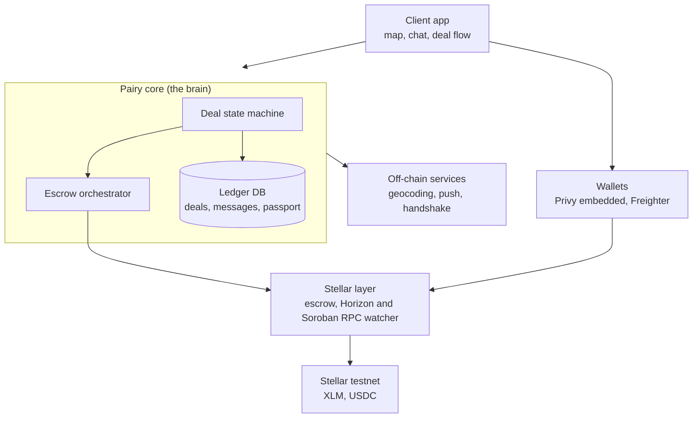
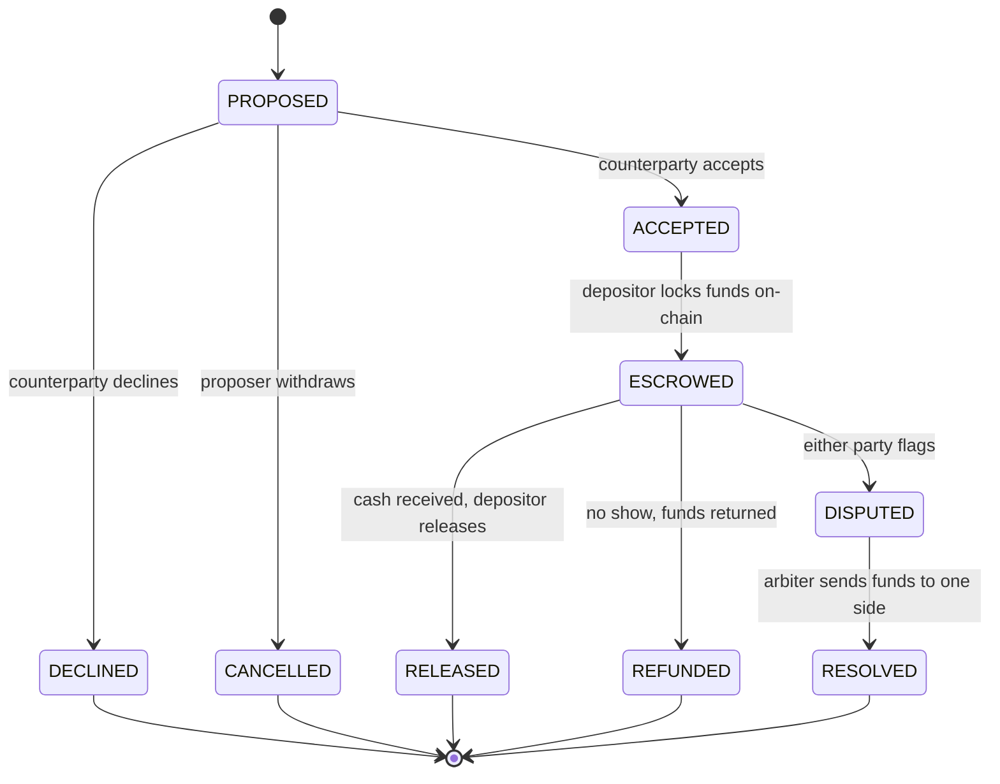

<h1 align="center">
  <picture>
    <source media="(prefers-color-scheme: dark)" srcset="assets/wordmark-dark.svg" />
    
  </picture>
</h1>

### Trade in person.

Pairy is a location-based, peer-to-peer cash and crypto exchange on Stellar. Meet someone near you, trade local cash for stablecoins or tokens face to face, and let an on-chain escrow protect both sides so nobody can walk off with the money.

---

## The problem

Buying or selling crypto for local cash still runs through channels with no safety net. Telegram OTC groups and informal middlemen offer no recourse: if the other side takes the cash and disappears, the money is gone. The regulated alternatives are a poor fit for this use case, crypto ATMs commonly charge 10 to 20 percent in fees and spread, and centralized exchanges need bank rails plus KYC and still take days to turn a balance into cash in hand.

Meeting in person is the most natural way for two people to trade, but nothing makes that meeting safe.

Stellar already has the settlement rails: sub-cent fees, fast finality, native USDC, and two ready ways to hold funds in escrow, a Soroban contract or native claimable balances with multisig. A trade can be locked on-chain and released only when both people confirm.

What is missing sits one layer up: the trust layer. Location-based discovery, a negotiate-then-lock deal flow, an in-person handshake, on-chain escrow, and a reputation record that together turn "meet a stranger to swap cash and crypto" into something with guardrails.

> The payment is a commodity, the trust flow is the product. Anyone can send USDC on Stellar. Letting two strangers swap cash and crypto in person without either getting robbed, through escrow, an in-person handshake, reputation, and dispute arbitration, is the hard part and the moat.

---

## How it works

Liam is a tourist in Canggu, Bali. He has USDC in his wallet but needs rupiah for the day. Wayan is nearby with cash and wants USDC.

1. **Sign in.** Liam signs in with email and gets a Privy embedded Stellar wallet provisioned automatically. Wayan connects her own Freighter wallet. Each claims a handle like `@liam.pairy`.
2. **Browse the map.** Liam opens the map and sees nearby listings as pins, including Wayan offering cash rupiah for USDC at her rate.
3. **Propose a deal.** Liam opens a chat. They agree on 200 USDC for 3,200,000 IDR and a warung in Canggu, then one of them sends a structured proposal the other accepts. No fees yet: negotiate first, lock last.
4. **Lock escrow.** Liam, the side holding crypto, deposits 200 USDC into the on-chain escrow on Stellar. Wayan can see that it is locked.
5. **Meet and settle.** They meet at the warung. A short-lived signed QR proves both are present. Wayan hands over the cash, Liam releases, and the 200 USDC lands in Wayan's wallet. If Liam refuses to release after taking the cash, Wayan opens a dispute and an on-chain arbiter decides where the funds go.
6. **Collect a stamp.** The settled trade geocodes the meeting spot into Liam's Trade Passport, a map of the cities he has traded in.

Every settlement is verifiable on `stellar.expert` by transaction hash. No engineering knowledge required to check it.

---

## Architecture

One rule defines the design: **Pairy never holds your money.** The on-chain escrow does, and the app only ever talks to the Pairy API, never to keys or the chain directly. Only the Stellar layer touches Stellar, only the escrow holds funds, and the core deal logic is chain-agnostic, so the escrow can be a Soroban contract or native primitives without the rest of the app caring.

### Deal lifecycle

The whole trade is one explicit, idempotent state machine. Nothing touches the chain until both sides commit, and on-chain state only ever moves forward.

The escrow exposes one lifecycle (deposit, release, refund, dispute, resolve) behind a single interface, so two implementations can be evaluated without changing the rest of the system:

- **A Soroban contract** in Rust that custodies XLM and Stellar Asset Contract tokens.
- **Native Stellar primitives**, claimable balances plus multisig, with no custom contract.

Curated design notes (architecture, flows, data model, contracts, api, testing) will live in `/docs` as the build lands.

---

## What we are building

A working, open-source, escrow-protected P2P swap flow on Stellar testnet, proven end to end by testnet transaction hashes. Everything below is planned. Nothing is built yet.

| Deliverable | What ships | How you verify it |
|---|---|---|
| **D1: Escrow and dual wallets** | The on-chain escrow on Stellar testnet (a Soroban contract or native claimable balances with multisig) exposing deposit, release, refund, dispute, and resolve, wired to both wallet paths (Privy embedded Stellar and Freighter). Tests and CI. | A deposit tx and a release tx for the same escrow on stellar.expert, and the escrow lifecycle test suite passing. |
| **D2: The P2P trade flow** | Location-based listings on a map, one to one chat with structured deal proposals, the negotiate-first-lock-last state machine, `@handle.pairy` onboarding, and the Trade Passport. | A full proposed to escrowed to released deal run end to end in the app, with the settlement tx visible on stellar.expert. |
| **D3: Hosted demo and packaging** | The full lifecycle as a hosted Stellar testnet demo, a public repo with a reproducible quickstart, and a short walkthrough video. | A live demo URL, the public repo, and a 2 minute walkthrough. |

Real fiat handling at scale, reputation hardening, and mainnet are explicitly later phases. The escrow interface and the chain-agnostic core are built as the hooks they plug into.

---

## Tech stack

| Layer | Choice |
|---|---|
| Framework | Next.js (App Router), React, TypeScript |
| API | tRPC |
| Stellar | `@stellar/stellar-sdk`, Soroban RPC, Horizon |
| Wallets | Privy (embedded Stellar) and Freighter |
| Escrow | Soroban (Rust) or native claimable balances with multisig |
| Database | Postgres with Drizzle ORM |
| UI | Tailwind CSS, Radix UI |
| Notifications | Web Push (VAPID) |
| Hosting | Vercel |

---

## Status

Pre-development, targeting Stellar testnet. Nothing is live, no real money moves, and there are no users yet. This README describes the design and the build plan. Progress is tracked against the deliverables above and verified by testnet transaction hashes.

## Contact

Questions and feedback: open an issue on this repository.

## License

[MIT](LICENSE).
