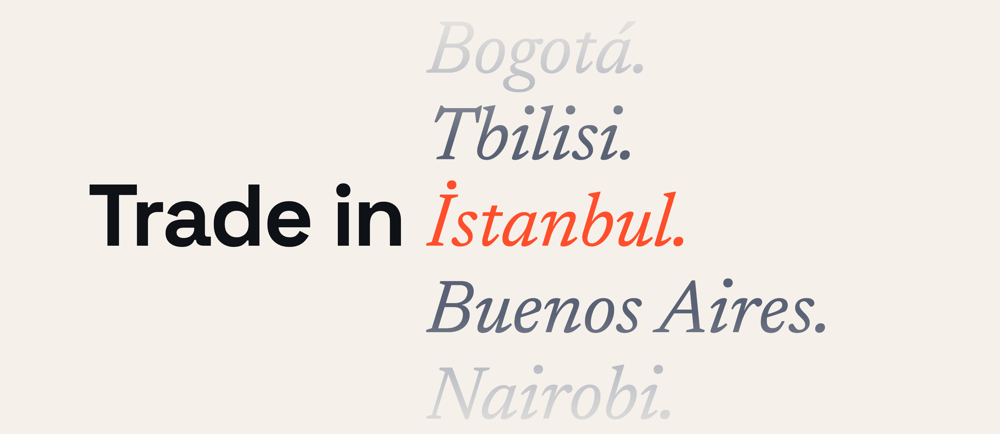
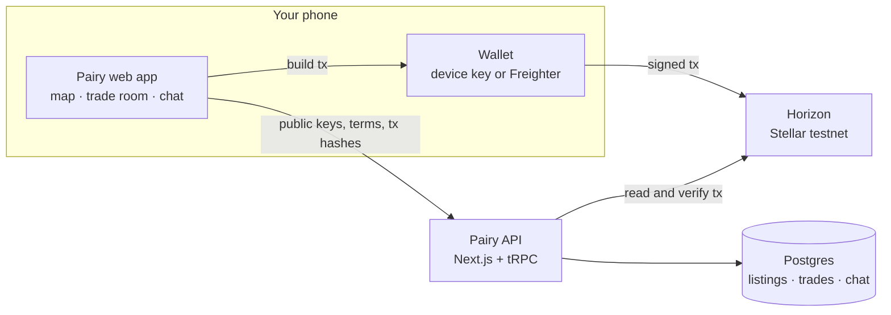
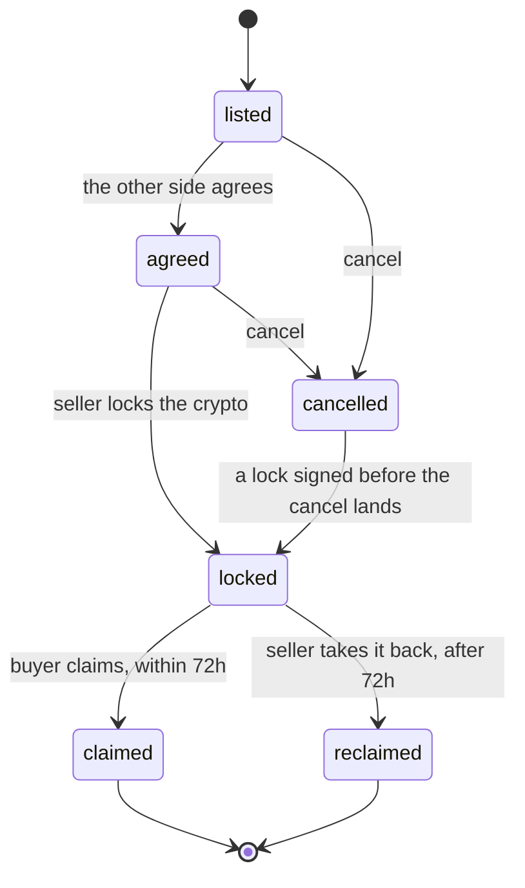

<div align="center">



<br />

Pairy helps two people in the same city swap local cash for XLM or USDC, face to face. The seller locks the crypto on Stellar for the buyer, and the buyer claims it on their own phone once the cash is in the seller's hand. Pairy holds no key and has no role in the lock.

[](https://stellar.org)
[](https://github.com/stellar/stellar-protocol/blob/master/core/cap-0023.md)
[](https://nextjs.org)
[](https://www.typescriptlang.org)
[](LICENSE)


[**Live demo**](https://pairy.org) · [**Evidence**](EVIDENCE.md) · [**Why not an escrow contract**](docs/settlement-rail-comparison.md)

</div>

---

## The problem

People already buy and sell crypto for cash in person. They find each other in Telegram and WhatsApp groups, meet a stranger, and hope. One side hands over the cash, the other is supposed to send the tokens, and if they don't, there is no recourse. Nothing holds the funds while the two people are standing there, and there is no trusted way to find someone nearby.

Stellar already has the primitive this needs. A claimable balance (CAP-23) can name exactly who may take the funds and when. Pairy builds the local, in-person flow around it: a map of offers by city, a chat for each trade, and a lock that only the buyer and the seller are on.

> Anyone can send XLM. Letting two strangers swap cash and crypto at a café table, with a lock that only the two of them are on and nobody else can touch, is the part that was missing.

---

## How it works

Liam is visiting İstanbul. He has 200 test USDC and needs lira for the week. Deniz lives in Kadıköy, has cash and wants USDC.

1. **Find a peer.** Liam opens the map and sees Deniz's listing pinned on İstanbul: buying USDC at 41.50 TRY each. The pin marks the city, never a person or an address.
2. **Agree the terms.** Liam opens a trade for 200 USDC. They use the trade's own chat to pick a café near the Moda pier. Nothing moves yet.
3. **Meet, then lock.** At the café, Liam locks the 200 USDC. The lock screen tells him plainly: from this moment Deniz can claim at any time in the next 72 hours, cash or not, so lock only when you are both there. Liam signs on his own phone.
4. **Cash, then claim.** Deniz hands over 8,300 TRY. Deniz taps **Claim** and signs on their own phone. The USDC is in Deniz's wallet. The trade is settled and its chat is deleted.

If Deniz never claims, the lock flips after 72 hours and Liam takes the USDC back himself. Every step has a receipt on [stellar.expert](https://stellar.expert/explorer/testnet) that anyone can open.

---

## Why it's safe

Every trade is one claimable balance with exactly two people on it:

| Who | Condition on the lock | In plain words |
|---|---|---|
| Buyer | `BEFORE_RELATIVE_TIME(259200)` | can claim during the first 72 hours |
| Seller | `NOT(BEFORE_RELATIVE_TIME(259200))` | can take it back from hour 72 on |

The two windows meet at exactly 72 hours and never overlap. There is no third claimant, no platform address, no dispute resolver and no Pairy signature anywhere in the settlement path. The Stellar network checks the conditions on every claim; Pairy only reads the result back.

**Who signs what.** The seller signs the lock. The buyer signs the claim. The seller signs the take-back. Each signature happens on that person's own device. Pairy's server never signs, never submits a transaction for anyone and never sees a private key. It reads finished transactions from Horizon and checks them before recording a step: the lock must have exactly these two claimants with exactly these conditions, or the server refuses it.

**The honest limit.** Pairy protects the buyer against a seller who takes the cash and never sends. It protects the seller only against a buyer who never claims, not against theft: once locked, the buyer can claim before handing over the cash. That is why the lock screen says so word for word and asks the seller to lock only at the meeting point. The cash itself never touches Pairy, and Pairy cannot see or verify it.

**Check it yourself.** Open any lock receipt on stellar.expert and find "created claimable balance". It must be claimable by exactly two accounts: the buyer "before 3 days from now" and the seller "after 3 days from now". If either says "unconditional", the lock is broken. Step-by-step instructions and every real transaction are in [EVIDENCE.md](EVIDENCE.md).

---

## Keys stay on your phone

There are two ways to hold a wallet. Neither gives Pairy custody.

- **A key made on this device.** The browser calls `Keypair.random()`, which draws from WebCrypto (`crypto.getRandomValues`). The key goes straight into SDF's `KeyManager` (`@stellar/typescript-wallet-sdk-km`): `ScryptEncrypter` locks it under a pincode you choose and `LocalStorageKeyStore` keeps only the ciphertext in the browser. Pairy writes no key-derivation or encryption code of its own.
- **Freighter**, connected through `@creit.tech/stellar-wallets-kit`. Your key stays in Freighter.

You sign in by signing a one-time message ([SEP-53](https://github.com/stellar/stellar-protocol/blob/master/ecosystem/sep-0053.md)) with your wallet. The key and the pincode are never sent to Pairy, and no API field is meant for, or named like, a secret key or a pincode. The CI test `no-secret-fields` fails the build if one is ever added.

**The tradeoff.** Pairy keeps no copy, so losing the device or forgetting the pincode loses the wallet. You can export an encrypted backup file and restore it in another browser with the same pincode. There is no server-side recovery, because that would be custody.

**The residual risk.** The encrypted key lives in browser storage, so a cross-site scripting flaw on Pairy's own site could read the ciphertext. This is a testnet demo. Passkey-wrapped storage is planned for evaluation before any mainnet work.

---

## What Pairy stores

**Stored:** Stellar public keys, listing terms, the city each listing picked, claimable balance IDs and transaction hashes, trade state, an optional public note on each listing, and each trade's chat while the trade is live.

**Deleted automatically:** a trade's chat, as soon as Pairy records the claim, the take-back or the cancel. The state change and the deletion happen in one database transaction, and the CI test `coordination-purge-on-terminal` checks it. A daily job ends trades nobody uses: a trade not yet locked with no activity for a week is cancelled (its chat goes with it), and a locked trade's chat is deleted a week after the buyer's claim window closed.

**Never stored:** private keys or anything a key could be derived from, pincodes, identity documents, or a precise location. Pairy has no field for names, phone numbers or emails; the listing note and the chat are free text, so don't put them there. Listings are placed at a city's centre, chosen from a list of cities with 100,000+ people. The app never asks for your device location.

**Seen outside Pairy's database:** your browser loads map tiles from OpenFreeMap and talks to Stellar's testnet Horizon (and Friendbot, when you fund a wallet) directly, so those services see your IP address, and Horizon sees which account it is asked about. Everything on Stellar, including who locked funds for whom, is public on the ledger. Pairy's host (Vercel) and database provider (Neon) keep their own request logs and backups for their retention periods, so a deleted chat can outlive the deletion there until those expire.

---

## Architecture



Transactions go from your wallet straight to Stellar. Pairy's API only ever receives public information and checks it against the chain.

### Trade lifecycle

`TradeStateMachine` ([lib/trade/state-machine.ts](lib/trade/state-machine.ts)) records what the chain has already accepted. It never decides whether a claim is allowed; the network does.



Once locked, a trade cannot be cancelled: the only ways out are claim and take-back. The chain outranks the app: if the seller's lock lands just after a cancel, the trade is recorded as locked rather than left showing "cancelled" over money that is on the ledger. `disputed` is a flag, not a state. Either side can raise it on a live trade; it changes nothing today and is the hook a Phase 2 arbiter will plug into.

Before the lock, the app checks what would otherwise fail later. For USDC, the buyer's wallet must accept USDC first (a trustline): the lock itself would succeed without it, but the buyer's claim would fail with `op_no_trust`. And the seller must hold the amount plus the network reserve (0.5 XLM per person on the lock), which comes back to the seller when the trade ends.

### The reusable part

[`lib/stellar/settlement.ts`](lib/stellar/settlement.ts) is the whole settlement surface, built only from stock SDK calls: `Claimant.predicateBeforeRelativeTime`, `Claimant.predicateNot`, `Operation.createClaimableBalance` and `Operation.claimClaimableBalance`, wrapped in `TransactionBuilder`. No contract, no predicate evaluation, no balance-ID derivation, no signing. The server reads a lock's balance ID back with the SDK's own `getClaimableBalanceId` when it verifies the lock ([`lib/stellar/verify.ts`](lib/stellar/verify.ts)). Together with the state machine it is meant as a worked example any Stellar P2P app can fork for two-party CAP-23 settlement.

---

## Tech stack

| Layer | Choice |
|---|---|
| App | Next.js 14 (App Router), React 18, TypeScript |
| API | tRPC 11, zod |
| Database | Postgres with Drizzle ORM (Neon in production, PGlite in tests) |
| Stellar | `@stellar/stellar-sdk` 17, Horizon testnet |
| Wallets | `@stellar/typescript-wallet-sdk-km`, `@creit.tech/stellar-wallets-kit` (Freighter) |
| Claim window | `stellar-resolve-claimant-predicates` |
| Map | MapLibre GL with OpenFreeMap tiles (no API key), GeoNames cities |
| UI | Tailwind CSS, Radix UI, the [Pairy brand system](docs/design.md) |
| Hosting | Vercel (Frankfurt), next to the Neon database |
| Tests | Vitest, GitHub Actions |

---

## Run it locally

You need Node 22 (see `.nvmrc`; the Stellar SDK requires `>=22.12`), pnpm and Docker.

```bash
nvm use
pnpm install
docker compose up -d          # Postgres on localhost:35433
cp .env.example .env          # DATABASE_URL and SESSION_SECRET
pnpm db:migrate
pnpm dev                      # http://localhost:3000
```

`SESSION_SECRET` signs the login cookie. It is not a Stellar key. In production, set `CRON_SECRET` (32+ random characters) too: Vercel Cron sends it to the daily cleanup job, which refuses every call without it. Run `pnpm db:migrate` against the production database before deploying code that needs a new migration. After a testnet reset, `pnpm tsx scripts/ops/testnet-reset.ts --before=<reset time>` lists the trades the reset wiped; `--apply` closes them.

## Tests

```bash
pnpm test           # unit and CI tests, no network needed
pnpm test:testnet   # lock, claim and take-back on the live Stellar testnet
```

The testnet suite funds throwaway accounts and runs every path for XLM and, when the testnet DEX can supply test USDC, for USDC too (otherwise the USDC cases are skipped and say so). The take-back test uses a 60-second window and waits it out, after checking that an early take-back is rejected by the network.

Two tests come straight from the project's scope and run as their own CI steps:

- **`no-secret-fields`** ([tests/ci/no-secret-fields.test.ts](tests/ci/no-secret-fields.test.ts)) walks every API input and fails if any field is meant for, or named like, a secret key or a pincode.
- **`coordination-purge-on-terminal`** ([tests/ci/coordination-purge-on-terminal.test.ts](tests/ci/coordination-purge-on-terminal.test.ts)) drives trades to claimed, taken back and cancelled, and checks the chat is gone each time.

---

## Scope

| Now | Later |
|---|---|
| Testnet XLM and testnet USDC | More assets (Phase 2) |
| Two-party lock, claim and take-back | Dispute resolution with an arbiter, using Trustless Work's escrow once a resolver role is justified (Phase 2) |
| Device keys and Freighter | Passkey-wrapped keys, native apps (Phase 3) |
| Testnet only | Mainnet, real money, identity checks (Phase 3) |

Pairy will not write a custom escrow contract in any phase. If the protocol primitive ever falls short, the gap gets documented and proposed upstream.

## Status

A working demo on the Stellar testnet at [pairy.org](https://pairy.org). No real money moves, and Pairy has no users: it is a reference implementation, not a product in use. Evidence for each deliverable is listed in [EVIDENCE.md](EVIDENCE.md) as it is produced.

## License

[MIT](LICENSE).
