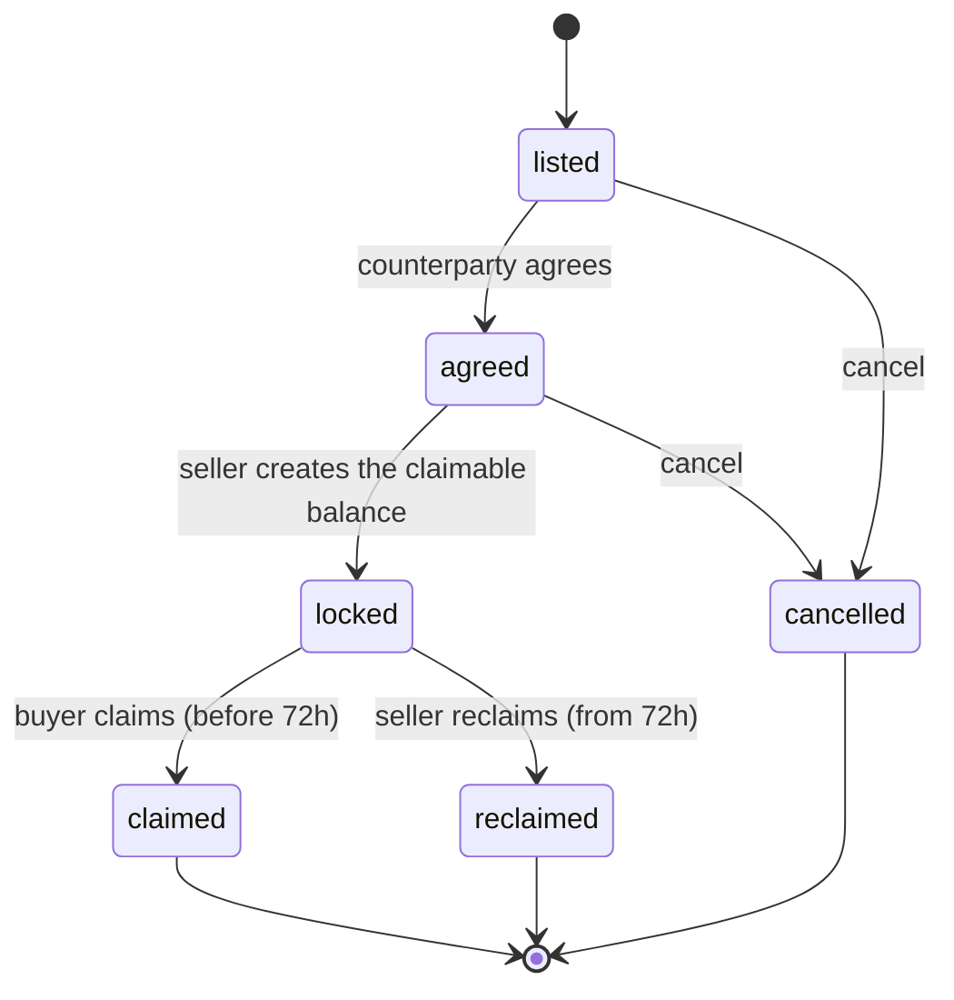

<div align="center">

<h1 align="center">
  <picture>
    <source media="(prefers-color-scheme: dark)" srcset="assets/wordmark-dark.svg" />
    
  </picture>
</h1>

In-person cash and crypto trades on the Stellar testnet, settled with claimable balances (CAP-23).

[](https://stellar.org)
[](LICENSE)


</div>

---

## What Pairy is

Pairy helps two people near each other agree a trade of local cash for crypto (testnet XLM or testnet USDC) and settle the crypto side on Stellar. Here is how a trade works. The seller lists an offer on a map, at the city level. A buyer agrees to it. When they meet, the seller locks the crypto in a claimable balance that only the buyer can claim during the next 72 hours. The buyer hands over the cash and claims the crypto from their own device. If the buyer never claims, the seller takes it back once the 72 hours are over. Pairy writes no smart contract and holds no key. Settlement uses Stellar's built-in claimable balances, created and claimed with the stock `@stellar/stellar-sdk`.

Pairy is a testnet reference implementation. It has zero users and moves no real money.

## Trust model

**The lock.** Every trade is one claimable balance with exactly two claimants:

| Claimant | Condition | Meaning |
|---|---|---|
| Buyer | `BEFORE_RELATIVE_TIME(259200)` | can claim during the first 72 hours after the lock |
| Seller | `NOT(BEFORE_RELATIVE_TIME(259200))` | can reclaim from hour 72 onward |

The two windows meet exactly at 72 hours and never overlap. There is no third claimant, no platform address, no dispute resolver and no Pairy signature anywhere in the settlement path. CAP-23 has no such roles.

**Who signs what.** The seller signs the lock. The buyer signs the claim, on their own device, at the meeting, once the cash has changed hands. The seller signs the reclaim, on their own device, after the window closes. Pairy's server never signs anything and never sees a private key. It only reads finished transactions back from Horizon to record what happened.

**What v1 protects, in one line:** v1 protects the buyer against a seller who takes cash and never sends, and protects the seller only against inaction, not against theft. Once the seller locks, the buyer can claim at any moment inside 72 hours, whether or not cash has changed hands. That is why the lock screen says so in plain words and recommends locking only when both people are at the meeting point. The cash leg is physical and off-chain; Pairy never sees it and cannot verify it.

Why claimable balances and not an escrow contract: [docs/settlement-rail-comparison.md](docs/settlement-rail-comparison.md).

## What Pairy stores, and what it does not

**Stored:** Stellar public keys, listing terms, claimable balance IDs and transaction hashes, trade state, and the per-deal chat while a trade is live.

**Per-deal chat** belongs to a single trade. The server deletes it as soon as the trade reaches a terminal state: claimed, reclaimed or cancelled. This happens automatically; nobody has to ask for it.

**Not stored:** private keys or anything a key could be derived from, pincodes, real names, phone numbers, identity documents, KYC data. Listings show a city or district the user picked, never a live or precise device position.

## Keys

There are two ways to hold a wallet. Neither one gives Pairy custody.

- **Freighter**, connected through `@creit.tech/stellar-wallets-kit`.
- **A wallet generated on the device.** The browser calls `Keypair.random()`, which draws its entropy from WebCrypto (`crypto.getRandomValues`). The keypair goes straight to SDF's `KeyManager` from `@stellar/typescript-wallet-sdk-km`. Its `ScryptEncrypter` encrypts the key under a pincode the user chooses, and `LocalStorageKeyStore` writes only the ciphertext to the device. Pairy writes no key-derivation or encryption code of its own. New testnet accounts are funded by Friendbot.

The key, encrypted or not, is never sent to Pairy. The pincode never leaves the device and is not a login credential. Login works by signing a one-time challenge message with the wallet. Pairy's API has no field, on any endpoint, that accepts a secret key or a pincode. The CI test `no-secret-fields` fails the build if one is added.

**The tradeoff.** Pairy keeps no server copy, so a lost device or a forgotten pincode means a lost wallet. Pairy therefore offers an export that the user starts and can re-import in another browser. There is no server-side recovery, because server-side recovery would be custody.

**The residual risk.** The scrypt-encrypted key sits in browser storage. A cross-site scripting flaw on Pairy's own origin could read it. v1 is testnet-only. Passkey-wrapped storage is a Phase 3 evaluation, before any mainnet consideration.

## Trade lifecycle

`TradeStateMachine` ([lib/trade/state-machine.ts](lib/trade/state-machine.ts)) is the off-chain record of a trade. It never decides whether a claim or reclaim is allowed; the chain decides that. The machine records what the chain has already accepted.



Once a trade is locked, it cannot be cancelled; the only ways out are claim and reclaim.

`disputed` is a flag, not a state. Either party can raise it on a trade that is not yet settled. The machine records it and does nothing else. It is the hook a Phase 2 arbiter will plug into.

**Preconditions handled before the lock:**

- **USDC needs a trustline.** USDC is not native. The lock itself can be created without the buyer's USDC trustline, but the buyer's claim would then fail with `op_no_trust`. The lock screen therefore blocks the seller until the buyer's trustline exists.
- **The seller pays the reserve, and gets it back.** The claimable balance ties up one base reserve per claimant against the seller's account. That reserve goes back to the seller on claim or reclaim, not to whoever claimed.

## Architecture

| Layer | Choice |
|---|---|
| App | Next.js 14 (App Router), React 18, TypeScript |
| API | tRPC 11, zod |
| Database | Postgres with Drizzle ORM (PGlite in tests) |
| Stellar | `@stellar/stellar-sdk` 17, Horizon (testnet) |
| Wallets | Freighter via `@creit.tech/stellar-wallets-kit`; device keys via `@stellar/typescript-wallet-sdk-km` |
| Claim-window countdown | `stellar-resolve-claimant-predicates` |
| Map | MapLibre GL with OpenFreeMap vector tiles (no API key, no account) |
| UI | Tailwind CSS, Radix UI |
| Tests | Vitest |

**`lib/stellar/settlement.ts` is the reusable part.** It contains the entire settlement surface and uses only stock SDK calls: `Claimant.predicateBeforeRelativeTime`, `Claimant.predicateNot`, `Operation.createClaimableBalance` and `Operation.claimClaimableBalance`. It has no predicate logic, no predicate evaluation, no signing code and no contract. Together with `lib/trade/state-machine.ts`, it is meant as a worked reference that any Stellar P2P app can fork for two-party CAP-23 settlement.

## Out of scope

- **Custom escrow contracts.** Pairy does not write one, in any phase. If the protocol primitive ever proves insufficient, we document the gap and propose it upstream instead of forking a contract.
- **Phase 2:** dispute resolution and the arbiter flow (v1 ships only the state-machine hook); integrating Trustless Work's already-deployed escrow once a dispute-resolver role is actually justified; assets beyond native testnet XLM and testnet USDC; any reputation layer.
- **Phase 3:** mainnet, real money, KYC and identity verification, native mobile apps, passkey-wrapped key storage.
- **Real-money trades.** Testnet only, at every stage.

## Running locally

Requirements: Node 22 (see `.nvmrc`; the Stellar SDK needs `>=22.12`), pnpm, and Docker for Postgres.

```bash
nvm use
pnpm install
docker compose up -d          # Postgres 16 on localhost:35433
cp .env.example .env          # DATABASE_URL and SESSION_SECRET
pnpm db:migrate
pnpm dev                      # http://localhost:3000
```

`SESSION_SECRET` signs the login session cookie. It is not a Stellar key.

## Tests

```bash
pnpm test           # unit and CI tests; no network needed
pnpm test:testnet   # integration tests against the live Stellar testnet
```

`pnpm test:testnet` funds throwaway accounts with Friendbot and runs lock, claim and reclaim on the real testnet. The reclaim test uses a 60-second window and waits it out during the run.

Two tests are named in the SOW and are part of CI:

- **`no-secret-fields`** ([tests/ci/no-secret-fields.test.ts](tests/ci/no-secret-fields.test.ts)) walks every API input schema. It fails if any field could carry a secret key or a pincode.
- **`coordination-purge-on-terminal`** ([tests/ci/coordination-purge-on-terminal.test.ts](tests/ci/coordination-purge-on-terminal.test.ts)) drives trades to claimed, reclaimed and cancelled. It checks that the trade's chat rows are gone each time.

The CI workflow on the public repository is planned and not yet set up. CI run links will go in [EVIDENCE.md](EVIDENCE.md).

## Status

In development, on the Stellar testnet only. Nothing is deployed yet and there are no users. Evidence for each deliverable (transaction hashes, CI runs, recordings, the demo URL) is collected in [EVIDENCE.md](EVIDENCE.md). Each item stays marked `PENDING` until it exists.

## License

[MIT](LICENSE).
