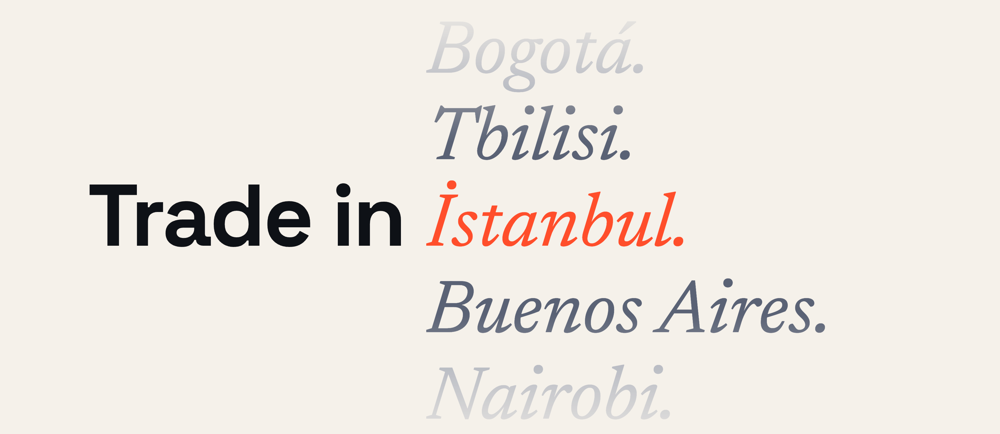
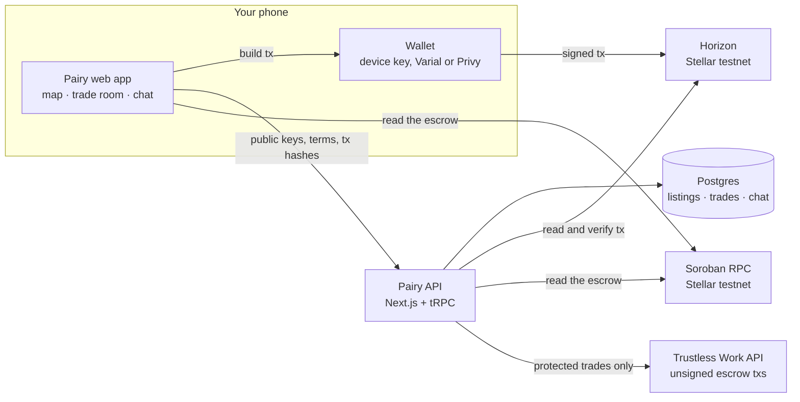
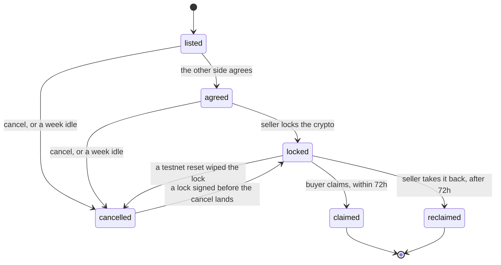
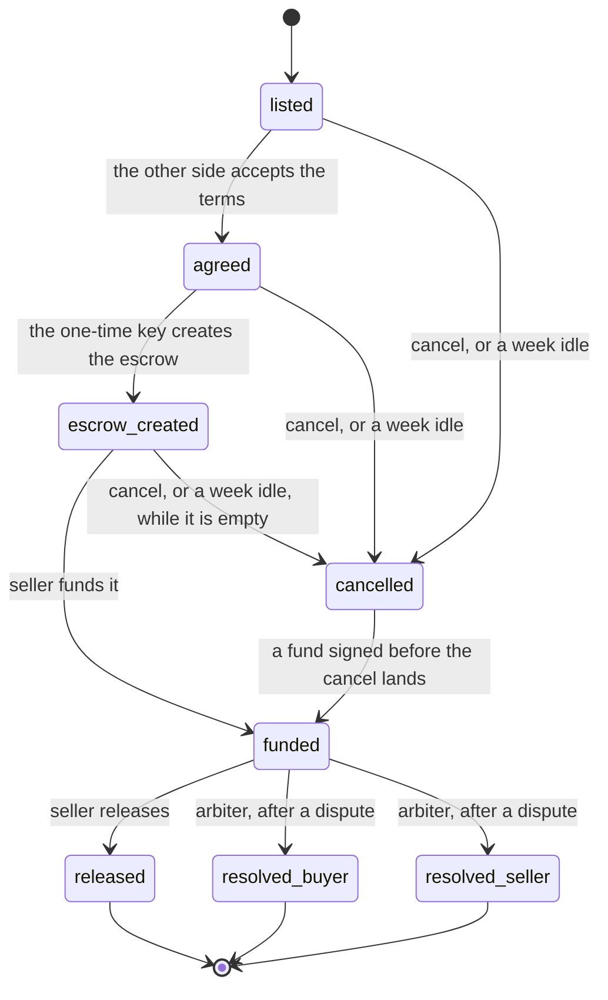

<div align="center">



<br />

Pairy helps two people in the same city swap local cash for XLM, USDC or EURC, face to face. The seller locks the crypto on Stellar for the buyer, and the buyer claims it on their own phone once the cash is in the seller's hand. Pairy holds no key and has no role in the lock. For USDC, the two can instead choose a [protected trade](#protected-trades): an escrow that an arbiter settles by a fixed, published rule if either of them opens a dispute.

[](https://stellar.org)
[](https://github.com/stellar/stellar-protocol/blob/master/core/cap-0023.md)
[](https://nextjs.org)
[](https://www.typescriptlang.org)
[](LICENSE)


[**Live demo**](https://pairy.org) · [**Evidence**](EVIDENCE.md) · [**Why not an escrow contract**](docs/settlement-rail-comparison.md)

</div>

---

## The problem

People already buy and sell crypto for cash in person. They find each other in Telegram and WhatsApp groups, meet a stranger, and hope. One side hands over the cash, the other is supposed to send the tokens, and if they don't, there is no recourse. Nothing holds the funds while the two people are standing there, and there is no trusted way to find someone nearby.

Stellar already has the primitive this needs. A claimable balance (CAP-23) can name exactly who may take the funds and when. Pairy builds the local, in-person flow around it: a map of offers by city, a chat for each trade, and a lock that only the buyer and the seller are on.

> Anyone can send XLM. Letting two strangers swap cash and crypto at a café table, with a lock that only the two of them are on and nobody else can touch, is the part that was missing.

---

## How it works

Liam is visiting Istanbul. He has 200 test USDC and needs lira for the week. Deniz lives in Kadıköy, has cash and wants USDC.

1. **Find a peer.** Liam opens the map and sees Deniz's listing pinned on Istanbul: buying USDC at 41.50 TRY each. The pin marks the city, never a person or an address.
2. **Agree the terms.** Liam opens a trade for 200 USDC. They use the trade's own chat to pick a café near the Moda pier. Nothing moves yet.
3. **Meet, then lock.** At the café, Liam locks the 200 USDC. The lock screen tells him plainly: from this moment Deniz can claim at any time in the next 72 hours, cash or not, so lock only when you are both there. Liam signs on his own phone.
4. **Cash, then claim.** Deniz hands over 8,300 TRY. Deniz taps **Claim** and signs on their own phone. The USDC is in Deniz's wallet. The trade is settled and its chat is deleted.

If Deniz never claims, the lock flips after 72 hours and Liam takes the USDC back himself. Every step has a receipt on [stellar.expert](https://stellar.expert/explorer/testnet) that anyone can open.

---

## Why it's safe

Every default trade is one claimable balance with exactly two people on it:

| Who | Condition on the lock | In plain words |
|---|---|---|
| Buyer | `BEFORE_RELATIVE_TIME(259200)` | can claim during the first 72 hours |
| Seller | `NOT(BEFORE_RELATIVE_TIME(259200))` | can take it back from hour 72 on |

The two windows meet at exactly 72 hours and never overlap. There is no third claimant, no platform address, no dispute resolver and no Pairy signature anywhere in the settlement path. The Stellar network checks the conditions on every claim; Pairy only reads the result back. A [protected trade](#protected-trades) is the one exception, and only when both traders choose it.

**Who signs what.** The seller signs the lock. The buyer signs the claim. The seller signs the take-back. In a protected trade, a one-time key made in the seller's browser signs the escrow's creation, the seller signs the fund and the release, the trader who opens a dispute signs it, and the arbiter's two signers each sign its resolution on their own computer. Each signature is made by that person's own wallet: on their own device or, for an email or Google wallet, by Privy once they confirm it on Pairy's signing screen. Pairy's server never signs, never submits a transaction for anyone and never sees a private key. It reads finished transactions from Horizon and checks them before recording a step: the lock must have exactly these two claimants with exactly these conditions, or the server refuses it. In a protected trade it also asks Trustless Work for each unsigned escrow transaction and checks it before anyone signs, and it joins the arbiter signers' signatures into one transaction, which the last signer's browser submits.

**The honest limit.** In a default trade, Pairy protects the buyer against a seller who takes the cash and never sends. It protects the seller only against a buyer who never claims, not against theft: once locked, the buyer can claim before handing over the cash. That is why the lock screen says so word for word and asks the seller to lock only at the meeting point. The cash itself never touches Pairy, and Pairy cannot see or verify it. A [protected trade](#protected-trades) changes who carries this risk.

**Check it yourself.** Open any lock receipt on stellar.expert and find "created claimable balance". It must be claimable by exactly two accounts: the buyer "before 3 days from now" and the seller "after 3 days from now". If either says "unconditional", the lock is broken. Step-by-step instructions and every real transaction are in [EVIDENCE.md](EVIDENCE.md).

---

## Keys stay with you

There are three ways to hold a wallet. None gives Pairy custody.

- **A key made on this device.** The browser calls `Keypair.random()`, which draws from WebCrypto (`crypto.getRandomValues`). The key goes straight into SDF's `KeyManager` (`@stellar/typescript-wallet-sdk-km`): `ScryptEncrypter` locks it under a pincode you choose and `LocalStorageKeyStore` keeps only the ciphertext in the browser. Pairy writes no key-derivation or encryption code of its own.
- **Varial (formerly Freighter)**, the Stellar wallet extension from [varialwallet.com](https://varialwallet.com), connected through `@creit.tech/stellar-wallets-kit`. Your key stays in Varial.
- **An email or Google login, through Privy** (`@privy-io/react-auth`). After you log in, Privy makes a Stellar wallet for you and Friendbot funds it on testnet. Privy's [security documentation](https://docs.privy.io/security/wallet-infrastructure/architecture) says the key is split into two shares and is whole only inside Privy's secure enclave while it signs, for your logged-in session. Pairy holds only Privy's public App ID, which is not a key, and turns on none of the Privy features that let an app sign: no session or agent signers, no authorization keys or key quorums, no custom login. Before every Privy signature, the sign-in included, Pairy's own screen says what you are signing; Privy then signs its hash. Pairy imports Privy in one browser file only, and the CI test `no-privy-signers` fails the build if Privy is imported anywhere else, or if a signer feature, a Privy server package or a login method other than email and Google appears.

You sign in by signing a one-time message ([SEP-53](https://github.com/stellar/stellar-protocol/blob/master/ecosystem/sep-0053.md)) with your wallet. The key and the pincode are never sent to Pairy, and no API field is meant for, or named like, a secret key or a pincode. The CI test `no-secret-fields` fails the build if one is ever added.

**The tradeoff.** Pairy keeps no copy of any key. A key on this device is lost with the device or a forgotten pincode; you can export an encrypted backup file and restore it in another browser with the same pincode. There is no server-side recovery, because that would be custody. An email or Google wallet is recovered by logging in: the same email or Google account opens the same wallet in any browser. Its honest limit is that whoever controls that email or Google account controls this wallet. To hold the key outside Privy, export it (below).

**The residual risk.** The encrypted key lives in browser storage, so a cross-site scripting flaw on Pairy's own site could read the ciphertext. For an email or Google wallet, the same flaw could ask Privy to sign while you are logged in: Privy shows no screen of its own for these signatures, so Pairy's signing screen is the only check. This is a testnet demo. Passkey-wrapped storage is planned for evaluation before any mainnet work.

### Use this key in Varial

A wallet opened with an email or Google login (Privy) can leave Pairy. **Export key** on the wallet page opens Privy's own screen; its **Copy key** button copies the private key to the clipboard without showing it, and Pairy never sees it. The key has one destination: the import field of Varial (formerly Freighter), the Stellar wallet extension. Install it only from [varialwallet.com](https://varialwallet.com) (freighter.app leads there too). Never paste it anywhere else: not into Pairy, a chat, a note, a search box, or a website that offers to convert or check a key. The one exception is the offline converter below.

1. In Varial, switch to **Test Net**. Click the wallet name at the top, choose **Add wallet**, then **Import a Stellar secret key**.
2. Paste the key, enter your Varial password, tick the box and choose **Import**. Then click the wallet name at the top again: the short address under it must match Pairy's wallet page (the same first and last four characters).

Varial takes a Stellar secret key: 56 characters starting with `S`. If it refuses the key although the password is right, Privy copied it as hex (`0x…`). Convert it on your own computer, in a new terminal window (macOS or Linux; on Windows use WSL), with Node.js 20 or newer. In an empty folder run `npm i @stellar/stellar-base@15.0.0` (npm warns that this package moved into `@stellar/stellar-sdk`; that is expected), then

```sh
node -e 'const {Keypair}=require("@stellar/stellar-base");let h="";process.stdin.on("data",d=>h+=d).on("end",()=>{const k=Keypair.fromRawEd25519Seed(Buffer.from(h.trim().replace(/^0x/i,"").slice(0,64),"hex"));console.log(k.publicKey());console.log(k.secret())})'
```

The command now waits for the key. Copying the commands above replaced the key in your clipboard, so press **Copy key** in Privy again, paste the key into the terminal, press Enter, then Ctrl-D. The command reads the key from the terminal, not from the command line, so it never lands in your shell history. It prints the G… address, which must match Pairy's wallet page, and then the `S…` key: copy that line and import it with steps 1 and 2. If it prints an error instead, stop: the key is in a form this note does not cover. Close the terminal window afterwards, and copy some other text so the key leaves your clipboard.

If Varial shows a different G… address, a different key went in. Varial cannot delete an account: rename that one (for example "wrong") and start again. Never use **Reset wallet** for this; it wipes every account in Varial.

From then on two things hold this key, Privy behind your login and Varial on that computer, and either one controls the wallet.

---

## Protected trades

A claimable balance cannot settle a disagreement: once the lock lands, the buyer can claim before handing over any cash. A protected trade is the opt-in alternative, for USDC only. The trader who opens the trade switches it on (it starts off), and both traders must accept its terms, shown word for word from [docs/arbitration.md](docs/arbitration.md), before any escrow exists. The server's `PROTECTED_MODE` setting can stop new protected trades; those already open carry on.

1. **Create.** The seller's USDC goes into a [Trustless Work](https://www.trustlesswork.com) escrow (V2, single release), deployed through Trustless Work's own factory; Pairy writes and deploys no contract of its own. A one-time key made in the seller's browser creates it from an account Friendbot funds, and is dropped once it has signed. The escrow names the seller as approver, service provider and release signer, the buyer as receiver, Pairy's platform account at a fee of 0, and the arbiter account as its only dispute resolver.
2. **Fund.** Before the seller funds it, the seller's browser reads the escrow straight from Soroban RPC and checks every term against the trade.
3. **Release.** The seller releases it with one signature (Trustless Work's `/approve-and-release-milestones` call). Trustless Work keeps 0.3% of every exit, refunds included: of 100 USDC, 99.7 is paid out.
4. **Or a dispute.** Only the buyer or the seller can open one, from "Flag a problem", by signing the escrow's dispute call. Each then answers one question, once, within 24 hours: "Was the cash handed over in full?" The two answers decide the outcome by [the rule](docs/arbitration.md#the-rule): all to the buyer, or all back to the seller. The arbiter applies it once both have answered or the 24 hours are over, and Pairy promises to do so within 72 hours of the dispute.

Trustless Work only prepares unsigned transactions. Pairy's server checks each one (contract, function, signer, amount, terms and its whole authorization tree) before handing it over, and the browser checks it again before anyone signs. For the arbiter's resolution the server changes one field, the time limit, to give two people on two computers an hour to sign; everything else stays byte for byte as Trustless Work prepared it. Pairy records a step only after reading it back from the chain.

**The arbiter** is one Stellar account, [`GCAQSD3C…XCPH`](https://stellar.expert/explorer/testnet/account/GCAQSD3CRZVO34O7AJJWVIRKI6HGTOKLG5WSX4WJJTNG3QQ6ZWPAXCPH), held by the two Pairy builders, Ömer Alpi and Ensar Mert Günay. Its own key is switched off and every threshold is 2, so both must sign. It cannot open a dispute and never reads the chat. Its page, `/arbiter`, is open only to the account's current signers, offers only the outcome the rule gives, and prepares exactly that one resolution; each signer signs it in Varial on their own computer.

**The honest limit.** A protected trade gives up the two-person lock. Once either trader opens a dispute, the arbiter's keys could send the whole escrow to any address: only Pairy's code limits them to the rule's outcome, which is why every resolution is public on stellar.expert and in Trustless Work's [escrow viewer](https://viewer.trustlesswork.com), checkable against the two answers both traders see. When the answers disagree, the seller gets the USDC back, so a seller who takes the cash and then answers no keeps both; the buyer should let go of the cash only when the release shows on screen. The escrow has no deadline: a stalled trade's USDC goes back to the seller only through a dispute. If either arbiter key is lost, a disputed trade's USDC stays in the escrow. Why the default trade still uses a claimable balance, and why a resolver is accepted here, is in the [settlement rail comparison](docs/settlement-rail-comparison.md).

### Every key a protected trade adds

| Key or account | Held by | Can | Cannot |
|---|---|---|---|
| Escrow creation key, one per trade | The seller's browser memory, only while it signs that escrow's creation; then dropped. Never sent to Pairy. | Sign that escrow's creation, as its admin. As admin it could in theory change the terms before funding or add a step after it; Pairy asks for neither, and the key is gone. | Move, redirect or settle the funds; change roles, amount or fee once funded; open a dispute; touch any other trade |
| Arbiter account | Ömer Alpi and Ensar Mert Günay together: its own key at weight 0, thresholds 2/2/2 | After a trader opens a dispute: send the whole escrow, less 0.3%, to any address. After an exit: sweep anything later sent to that escrow. Pairy offers only the rule's outcome, never the sweep. | Open a dispute; touch an undisputed protected trade or any claimable-balance trade. With either key lost, disputed trades stay locked: there is no one-person recovery. |
| Arbiter signer keys | Each in its builder's own Varial, on their own computer; used only to sign as the arbiter | Co-sign as the arbiter (weight 1 each); sign in to `/arbiter` | Sign alone; be a party to a protected trade |
| Platform account | Nobody: its own key went to weight 0 in the same transaction that added its USDC trustline | Receive a platform fee, which is 0 | Sign anything, so nobody can use its right to open a dispute |
| Trustless Work API key | Pairy's server only: the production key in production, a separate development key for the team's test runs, none in CI | Ask Trustless Work for unsigned escrow transactions | Sign or move anything |

---

## What Pairy stores

**Stored:** Stellar public keys, listing terms (including how much of each listing is still open to new trades), the city each listing picked, claimable balance IDs and transaction hashes, trade state, an optional public note on each listing, and each trade's chat while the trade is live. For a protected trade also: the escrow's address and its creation account's address, the version of the protected-trade terms both traders accepted and when each did, each trader's yes-or-no dispute answer with an optional note of up to 500 characters, and each resolution the arbiter's page prepared, with the signatures collected on it. One signature alone is below the arbiter's threshold and moves nothing, and the transaction can only be sent exactly as prepared.

**Deleted automatically:** a trade's chat, as soon as Pairy records the claim, the take-back, the cancel, the release or the arbiter's resolution. A protected trade's dispute notes go with it; the two yes-or-no answers stay in the trade's timeline. The state change and the deletion happen in one database transaction, and the CI test `coordination-purge-on-terminal` checks it. A daily job ends trades nobody uses: a trade not yet locked or funded with no activity for a week is cancelled (its chat goes with it), and a locked trade's chat is deleted a week after the buyer's claim window closed. A trade flagged with a problem is the exception: the job leaves it and its chat alone while the two traders sort it out. No arbiter reads any chat.

**Never stored:** private keys or anything a key could be derived from, pincodes, identity documents, or a precise location. Pairy has no field for names, phone numbers or emails: an email or Google wallet reaches Pairy's server only as its Stellar address, and the login itself stays with Privy (and Google). The listing note, the chat and a dispute note are free text, so don't put them there. Listings are placed at a city's centre, chosen from a list of cities with 100,000+ people. The app never asks for your device location.

**Seen outside Pairy's database:** your browser loads map tiles from OpenFreeMap and talks to Stellar's testnet Horizon (and Friendbot, when a wallet or a protected trade's creation account is funded) directly, so those services see your IP address, and Horizon sees which account it is asked about. In a protected trade your browser also reads the escrow from Stellar's testnet Soroban RPC, which sees your IP address and which escrow it is asked about. Pairy's server, not your browser, asks Trustless Work's API for each escrow transaction, and sends it the trade's ID, both traders' addresses and the amount; all of these are public in the escrow anyway, and anyone can open it in Trustless Work's escrow viewer. When Pairy runs with a Privy App ID, the app's pages (not the landing page) load Privy's SDK for every visitor, whatever wallet they use; on each load it talks to Privy, sends Privy's own analytics events and asks WalletConnect's registry for its wallet list, so Privy and WalletConnect see your IP address. If you log in with email or Google, Privy also holds that email or Google account. Everything on Stellar, including who locked funds for whom, is public on the ledger. Pairy's host (Vercel) and database provider (Neon) keep their own request logs and backups for their retention periods, so a deleted chat can outlive the deletion there until those expire.

---

## Architecture



Transactions go from your wallet straight to Stellar. Pairy's API only ever receives public information and checks it against the chain. In a protected trade it also gets each escrow transaction, unsigned, from Trustless Work, and checks it before your wallet sees it.

### Trade lifecycle

`TradeStateMachine` ([lib/trade/state-machine.ts](lib/trade/state-machine.ts)) records what the chain has already accepted. It never decides whether a claim is allowed; the network does.



Once locked, a trade cannot be cancelled: the only ways out are claim and take-back. The one exception is a Stellar testnet reset, which wipes every account and lock; a script then closes those trades (see [Run it locally](#run-it-locally)). The chain outranks the app: if the seller's lock lands just after a cancel, the trade is recorded as locked rather than left showing "cancelled" over money that is on the ledger. A trade not yet locked that sees no activity for a week is cancelled by a daily job. `disputed` is a flag, not a state. In a default trade either side can raise it on a live trade; it moves no money, and no arbiter sees it. The daily job leaves flagged trades and their chat alone.

A protected trade has its own states, each recorded only once the chain shows it:



Once funded, the only ways out are the seller's release and the arbiter's resolution. Here `disputed` comes only from the chain: it is set when a trader's dispute transaction is read back from the ledger, and only then can the arbiter act. The daily job never cancels a funded trade; it checks funded trades against the chain instead, so a dispute or release made outside Pairy's app is still recorded.

Before the lock, the app checks what would otherwise fail later. For USDC, the buyer's wallet must accept USDC first (a trustline): the lock itself would succeed without it, but the buyer's claim would fail with `op_no_trust`. And the seller must hold the amount plus the network reserve (0.5 XLM per person on the lock), which comes back to the seller when the trade ends.

### The reusable part

[`lib/stellar/settlement.ts`](lib/stellar/settlement.ts) is the whole settlement surface, built only from stock SDK calls: `Claimant.predicateBeforeRelativeTime`, `Claimant.predicateNot`, `Operation.createClaimableBalance` and `Operation.claimClaimableBalance`, wrapped in `TransactionBuilder`. No contract, no predicate evaluation, no balance-ID derivation, no signing. The server reads a lock's balance ID back with the SDK's own `getClaimableBalanceId` when it verifies the lock ([`lib/stellar/verify.ts`](lib/stellar/verify.ts)). Together with the state machine it is meant as a worked example any Stellar P2P app can fork for two-party CAP-23 settlement.

---

## Tech stack

| Layer | Choice |
|---|---|
| App | Next.js 14 (App Router), React 18, TypeScript |
| API | tRPC 11, zod |
| Database | Postgres with Drizzle ORM (Neon in production, PGlite in tests) |
| Stellar | `@stellar/stellar-sdk` 17, Horizon and Soroban RPC (testnet) |
| Wallets | `@stellar/typescript-wallet-sdk-km`, `@creit.tech/stellar-wallets-kit` (Varial), `@privy-io/react-auth` 3.51.1 (email or Google) |
| Protected trades | Trustless Work's V2 escrow API, called through Pairy's own `fetch` + zod client; no Trustless Work SDK |
| Claim window | `stellar-resolve-claimant-predicates` |
| Map | MapLibre GL with OpenFreeMap tiles (no API key), GeoNames cities |
| UI | Tailwind CSS, Radix UI, the [Pairy brand system](docs/design.md) |
| Hosting | Vercel (Frankfurt), next to the Neon database |
| Tests | Vitest, GitHub Actions |

---

## Run it locally

You need Node 22 (see `.nvmrc`; the Stellar SDK requires `>=22.12`), pnpm and Docker.

```bash
nvm use
pnpm install
docker compose up -d          # Postgres on localhost:35433
cp .env.example .env          # then set SESSION_SECRET (32+ random characters)
pnpm db:migrate
pnpm dev                      # http://localhost:3000
```

`SESSION_SECRET` signs the login cookie. It is not a Stellar key. In production, set `CRON_SECRET` (32+ random characters) too: Vercel Cron sends it to the daily cleanup job, which refuses every call without it. Run `pnpm db:migrate` against the production database before deploying code that needs a new migration. After a testnet reset, `DATABASE_URL=... pnpm tsx scripts/ops/testnet-reset.ts --before=<reset time>` lists the trades the reset wiped; `--apply` closes them. `DATABASE_URL=... pnpm tsx scripts/ops/protected-report.ts` prints every protected trade's dispute times, answers, outcome, resolutions and missed 72-hour promises as Markdown (`--json` for JSON); it writes, signs and sends nothing.

## Tests

```bash
pnpm test           # unit and CI tests, no network needed
pnpm test:testnet   # lock, claim and take-back on the live Stellar testnet
```

The testnet suite funds throwaway accounts and runs every path for XLM, and for USDC and EURC when the testnet DEX or the team's treasury account can supply them (otherwise those cases are skipped and say so). The take-back test uses a 60-second window and waits it out, after checking that an early take-back is rejected by the network.

Five tests come straight from the project's scope and run as their own CI steps:

- **`no-secret-fields`** ([tests/ci/no-secret-fields.test.ts](tests/ci/no-secret-fields.test.ts)) walks every API input and fails if any field is meant for, or named like, a secret key or a pincode. It also fails if app or server code outside the device wallet and the escrow creation key can make a Stellar key, or if anything on the server side signs.
- **`coordination-purge-on-terminal`** ([tests/ci/coordination-purge-on-terminal.test.ts](tests/ci/coordination-purge-on-terminal.test.ts)) drives trades to claimed, taken back, cancelled, released and resolved, and checks the chat, and a protected trade's dispute notes, are gone each time.
- **`tw-endpoint-allowlist`** ([tests/ci/tw-endpoint-allowlist.test.ts](tests/ci/tw-endpoint-allowlist.test.ts)) pins the only Trustless Work calls Pairy can make, keeps them and the API key in one server file, keeps the arbiter's inputs free of any address, amount or outcome, and fails if server code submits a transaction.
- **`no-privy-signers`** ([tests/ci/no-privy-signers.test.ts](tests/ci/no-privy-signers.test.ts)) fails if Privy is imported outside its one browser file, or if a signer, delegation or custom-login feature, a Privy server package or a login method other than email and Google appears.
- **`listing-reservation-concurrency`** ([tests/ci/listing-reservation-concurrency.test.ts](tests/ci/listing-reservation-concurrency.test.ts)) opens two trades at once that together exceed a listing and checks only one is accepted. A second CI job runs the same race on a real Postgres, where the listing's row lock is what stops it.

---

## Scope

| Now | Later |
|---|---|
| Testnet XLM, USDC and EURC; listings that show how much is left | More assets |
| Two-party lock, claim and take-back, the default | |
| Opt-in protected USDC trades: a Trustless Work escrow, with a 2-of-2 arbiter applying a fixed rule | Independent arbiter signers: 3-of-5, then a council (Phase 3) |
| Device keys, Varial (formerly Freighter), email or Google wallets (Privy) | Passkey or Face ID login with Secure-Enclave keys, native apps (Phase 3) |
| Testnet only | Mainnet, real money, identity checks (Phase 3) |

Pairy will not write a custom escrow contract in any phase. If the protocol primitive ever falls short, the gap gets documented and proposed upstream.

## Status

A working demo on the Stellar testnet at [pairy.org](https://pairy.org). No real money moves, and Pairy has no users: it is a reference implementation, not a product in use. Evidence for each deliverable is listed in [EVIDENCE.md](EVIDENCE.md) as it is produced.

## License

[MIT](LICENSE).
